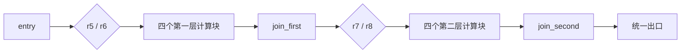

# Offset Register 协议与示例

本仓库公开 `orsim/v1` 协议和精选 JSON case，用于讨论 offset register 的数据流表示、COPY 成本以及控制流汇合时的相对索引对齐。完整的指令字段、整数边界和执行语义见 [PROTOCOL.md](PROTOCOL.md)。

## 核心概念

OR 指令的结果依次进入临时值历史。在当前指令中，`t#1` 引用实际执行路径上最近产生的值，`t#2` 引用再前一个值。`bit_width=3` 时，最大可引用偏移是 `t#8`。`COPY` 从历史中读取一个值，再把它追加为最新值；它既可延长内部值的可引用时间，也可调整控制流汇合处的相对位置。

每个 case 的 `source` 展示计算意图，`ir`（如有）用具名变量和指令表达数据流，`instructions` 是使用 `t#n` 的 OR 指令序列。IR 中的 `MOV` 是变量赋值；OR 中的 `COPY` 是实际产生新临时值的指令。JSON 数组中的每条指令各占一行。

## Case

| 文件 | 内容 |
| --- | --- |
| [example.json](example.json) | `(r1 + r2)^2` 写回 `r1`；同时展示 source、IR 和 OR。 |
| [control_flow_alignment.json](benchmarks/control_flow_alignment.json) | 两次分支与汇合，展示路径间的相对索引对齐。 |
| [cfg_two_layer_alignment.json](benchmarks/cfg_two_layer_alignment.json) | 两层四路控制流，多个基本块参与汇合对齐。 |
| [cfg_copy_explosion.json](benchmarks/cfg_copy_explosion.json) | 两层四路控制流与交叉数据依赖；同时包含具名变量 IR 和 OR。 |

## COPY 压力与调度对照

| Case | 计算与 COPY 来源 | 静态 COPY |
| --- | --- | ---: |
| [内部刷新](benchmarks/copy_pressure_internal.json) / [外部重读](benchmarks/copy_pressure_reload.json) | 同一段 128 步累加：前者用 COPY 延续内部值，后者在对应位置重新 GET 外部寄存器。 | 18 / 0 |
| [多状态 DAG](benchmarks/dataflow_dag.json) | 三个状态交叉更新，共享中间值并复用一个 seed。 | 17 |
| [五状态原始调度](benchmarks/rolling_dag.json) / [零 COPY 调度](benchmarks/rolling_dag_zero_copy.json) | 相同源码、相同输入输出与 8 轮计算；只改变 ADD 顺序，COPY 从 57 降为 0。 | 57 / 0 |
| [六路交错](benchmarks/straight_fanout_interleaved.json) / [六路分组](benchmarks/straight_fanout_grouped.json) | 相同内部 seed、六个 lane 各更新 12 次；改变调度后 COPY 从 11 增至 216。 | 11 / 216 |

两个新增 case 均有 `source`、`ir`、OR 指令；研究背景和后续 benchmark 方向见 [STRAIGHT_RESEARCH.md](benchmarks/STRAIGHT_RESEARCH.md)。这些 COPY 计数对应文件中写定的指令顺序，不代表计算本身必须复制。所有 case 固定使用 `bit_width=3`。本仓库只提供协议与示例数据。

`bit_width` 是偏移量的编码宽度，允许的最大 `n` 为 `2^bit_width`。寄存器数值固定为有符号 64 位整数，范围 `[-2^63, 2^63-1]`；输入值和算术结果越界都会报错，不会静默回绕。引用必须同时指向已经产生的 `t` 值。

OR 与具名变量 IR 现在共同支持常量、加减乘除与取余、取负、位运算、移位、整数比较和条件选值。比较产生 `0/1`，可直接送入 `BR` 形成由块内计算决定的控制流。每条指令的字段及除法、移位、溢出语义见 [PROTOCOL.md](PROTOCOL.md)。

## 运行

需要 Python 3.10 或更新版本，无第三方依赖。块文件的 `instructions` 必须是 JSON 数组，见 [example.json](example.json)。示例同时给出 `source`、具名变量 `ir` 和最终 offset 指令；`source` 用于阅读，`ir` 与 `instructions` 可分别执行。

```sh
python3 orsim.py example.json --registers '{"r1": 3, "r2": 4}'
# {"r1": 49, "r2": 4}
```

`--registers` 提供执行前的绝对寄存器值，值必须是整数。`GET` 读取当前值；`SET` 将第二个输入引用的临时值写入第一个输入指定的绝对寄存器。`ADD` 和 `MUL` 的两个输入均为 `t#n`，并按数学整数运算。`GET` 读取未定义的寄存器、无效的偏移引用或不支持的指令会报错。

## 块内控制流

[control_flow.json](control_flow.json) 包含一个分支：先计算 `r1 + r2`，然后检查外部寄存器 `flag`。非零时将和平方后写回 `r1`；零时直接将和写回。`BR` 的输入是条件 `t#n` 和目标标签，条件非零则跳转；`JMP` 无条件跳转；`LABEL` 声明跳转目标。这三种指令都不产生临时值。跳过的指令不进入 `t` 历史；向后跳转重新执行的指令会再次产生值。

```sh
python3 orsim.py control_flow.json --registers '{"r1": 3, "r2": 4, "r3": 1}'
# {"r1": 49, "r2": 4, "r3": 1}
python3 orsim.py control_flow.json --registers '{"r1": 3, "r2": 4, "r3": 0}'
# {"r1": 7, "r2": 4, "r3": 0}
```

标签必须在同一块中定义且不能重名。每次执行最多走 10000 条指令；Python API 可以通过 `max_steps` 参数调整上限。

循环例子见 [factorial.json](factorial.json)。输入 `n` 应为非负整数；它用 `dec=-1` 作为减一常量，通过 `ADD` 实现 `n = n - 1`，循环计算阶乘：

```sh
python3 orsim.py factorial.json --registers '{"r3": 5, "r1": 1, "r2": -1}'
# {"r1": 1, "r2": -1, "r3": 0, "r4": 120, "r5": 120}
```

这里 `LABEL`、`BR` 和 `JMP` 组成循环控制流；每次回到 `loop` 后，新的 `GET` 和运算会追加新的临时值，`t#1`、`t#2` 始终相对于当前执行位置计算。

也可以从 Python 调用：

```python
import json
from orsim import simulate

with open("example.json", encoding="utf-8") as f:
    result = simulate(json.load(f), {"r1": 3, "r2": 4})
assert result == {"r1": 49, "r2": 4}
```

运行测试：`python3 -m unittest discover -s tests`。

## source 与指令流交叉验证

`source` 是给人看的源码描述；`ir` 用变量名显式连接数据流和控制流；`instructions` 使用 `t#n` 表示相对位置。完整字段见 [PROTOCOL.md](PROTOCOL.md)。例如 `sum = r1 + r2` 在 IR 中写成 `GET a/r1`、`GET b/r2`、`ADD sum/a/b`，在 OR 中则由 `ADD t#1/t#2` 读取最近两个生产者。复杂 CFG 的 [IR](benchmarks/cfg_copy_explosion.json) 用统一的 `s0` 至 `s4` 变量接收每条前驱路径的结果，OR 在同一汇合点需要把五个值排到统一偏移。

为了验证这几层表达同一逻辑，项目提供独立的 Python reference model：

```sh
python3 benchmarks/validate_cases.py
```

该命令对每个 case 使用多组初始寄存器，分别运行 source model 和 `orsim`，逐个比较完整寄存器结果；有 `ir` 的 case 还运行 `simulate_ir()`。当前 15 个 case 共验证 101 组输入；任何结果不一致都会以失败退出。

## STRAIGHT 相关 benchmark

[STRAIGHT_RESEARCH.md](benchmarks/STRAIGHT_RESEARCH.md) 记录了 STRAIGHT 论文中与距离型操作数和代码生成有关的可验证问题。新增的 [交错编排](benchmarks/straight_fanout_interleaved.json) 与 [分组编排](benchmarks/straight_fanout_grouped.json) 使用同一份六路数据流和 `bit_width=3`：交错更新需要 11 次 COPY，按 lane 分组需要 216 次，计算结果完全相同。这个对照用于观察调度如何改变相对索引窗口压力；COPY 数是各自固定指令流的成本，不是算法下界。

## 两层四路 CFG 对齐

[cfg_two_layer_alignment.json](benchmarks/cfg_two_layer_alignment.json) 展示多个基本块共同参与的对齐。两个条件先选出四个计算块之一，它们汇入 `join_first`；共享计算 `p/q` 后，再由两个条件选出另一组四个计算块，汇入 `join_second`。条件分支的落空边也有独立 `LABEL`，因此共有 21 个显式基本块、16 条完整路径。



第一处公共代码要求 `t#4/t#3/t#2/t#1` 依次表示 `x/y/z/w`；第二处要求 `t#3/t#2/t#1` 表示 `t/u/v`。前驱块按不同顺序产生这些值，有些路径在跳到汇合块前连续 `COPY` 四次或三次。两次汇合共 21 条静态 COPY；一条实际路径执行 0、3、4 或 7 条。所有路径都固定 `bit_width=3`，且经过相同的汇合后继指令。这个 case 用路径末尾的 COPY 明确展示对齐，未证明这些 COPY 是最优调度的下界。

```sh
python3 benchmarks/generate_cfg_alignment.py
python3 benchmarks/run_cfg_alignment.py
python3 benchmarks/validate_cases.py
```

## 长数据流与两层四路汇合

[cfg_copy_explosion.json](benchmarks/cfg_copy_explosion.json) 将五个内部状态从第一层四路分支传到 `join_first`，再从该汇合点传入第二层四路分支，最后四路汇入 `join_second`。每个计算块使用**两张不同的依赖图**，各包含五个共享的 `p`、三个进一步共享的 `q` 和五个下一状态，共 26 次 ADD。`p`、`q` 和下一状态各有交叉使用；最后一个下一状态还依赖此前产生的下一状态。这些依赖决定了同一块内多个值必须交错存活。五个初始状态只在第一层叶块读取一次，第二层直接使用第一次汇合留下的 `t` 值。四个标志位 `r6` 至 `r9` 选择两层的计算方式，因此共有 16 条完整路径。`source` 字段给出具体公式，独立的 Python model 对所有路径逐一核对。

```c
state = [r1, r2, r3, r4, r5];
for ((a, b) in [(r6 != 0, r7 != 0), (r8 != 0, r9 != 0)]) {
    x[i] = state[(i + a) % 5];
    p[i] = x[i] + x[(i + 1) % 5]; // i = 0..4
    q = [p[0]+p[b ? 2 : 3], p[1]+p[3], p[2]+p[4]];
    state = [q[0]+q[1], q[1]+q[2], q[2]+p[0], q[0]+p[3],
             (q[0]+q[1])+(q[2]+p[0])];

    x[i] = state[(i + a + 1) % 5];
    p[i] = x[i] + x[(i + 1) % 5];
    q = [p[0]+p[b ? 3 : 2], p[1]+p[4], p[2]+p[3]];
    state = [q[0]+q[2], q[1]+p[0], q[2]+q[1], q[0]+p[4],
             (q[0]+q[2])+(q[0]+p[4])];
}
[r10, r11, r12, r13, r14] = state;
r15 = sum(state);
```

此 case 固定 `bit_width=3`，有 21 个显式基本块和 466 条静态指令，其中 181 条是 COPY。单条路径实际执行 30 至 58 条 COPY；其中 24 至 48 条发生在交叉计算内部，汇合前对齐占 5 至 10 条。最长连续 COPY 段为 5 条。149 条静态 COPY 读取 `t#8`：内部值到达窗口边界时才刷新；较小偏移主要用于汇合处的位置对齐。两个汇合点各有四个直接前驱，公共后继按统一的相对位置读取五个状态。相比此前的 12 轮五状态环，这份 case 的压力主要来自单个 DAG 内的共享和交叉依赖；这些数字仍是当前固定顺序和刷新策略下的成本，不是所有合法调度的 COPY 下界。

```sh
python3 benchmarks/generate_cfg_copy_explosion.py
python3 benchmarks/run_cfg_copy_explosion.py
python3 benchmarks/validate_cases.py
```

## 控制流汇合处的相对索引对齐

[control_flow_alignment.json](benchmarks/control_flow_alignment.json) 有两次分支与汇合。第一次两条路径产生 `x/y/z`，第二次产生 `t/u/v`；两条路径的计算顺序和已产生的 `t` 数量不同。每个汇合点后只有一份公共指令流，因此它要求两条路径都满足：`t#3` 是第一项、`t#2` 是第二项、`t#1` 是第三项。

真分支先按不同顺序算出这些值，再连续执行三条 `COPY` 把它们排到相同相对位置；假分支天然按目标顺序产出。两次汇合共 6 条静态 COPY，实际执行取决于分支条件，可能是 0、3 或 6 条。去掉第一处对齐 COPY，公共指令就会读取错误的逻辑值。

```sh
python3 benchmarks/generate_control_flow_alignment.py
python3 benchmarks/run_control_flow_alignment.py
```

这展示的是**路径间的相对索引对齐成本**。路径历史的绝对长度可以不同，只要汇合处所需逻辑值在各条路径上的相对位置一致，公共指令就能正常运行。

## 短生命周期、多路交叉依赖

[rolling_dag.json](benchmarks/rolling_dag.json) 让五个状态每轮同时生成下一轮状态：`next[i] = s[i] + s[(i+1)%5]`，共 8 轮。旧状态只存活到本轮末尾，却会在多条新状态计算中重复使用。所有输入仅在开头 GET，输出仅在末尾 SET，`bit_width` 固定为 3。

原始生成器固定按 `0,1,2,3,4` 计算五条边。它在最旧的活跃值到达 `t#7` 时将其 COPY 到末尾，以免后续运算把该值推出 `t#8`。这份调度共有 107 条指令、57 次 COPY，最长连续 5 次 COPY；逐条删除 COPY 均会使原指令流报错或改变结果。

重新安排每轮五条 ADD 的顺序为 `0,1,2,4,3`，得到 [零 COPY 版本](benchmarks/rolling_dag_zero_copy.json)：相同源码、相同 `bit_width=3`、相同的 5 次 GET 和 5 次 SET，只需 50 条指令，其中 40 次 ADD、**0 次 COPY**，最大偏移为 `t#8`。因此原始版本的 57 次 COPY 完全是这份调度的成本，不能据此推断算法必须复制。这个对比说明调度搜索对 COPY 成本至关重要。

```sh
python3 benchmarks/generate_rolling_dag.py
python3 benchmarks/generate_rolling_zero_copy.py
python3 benchmarks/run_rolling_dag.py
python3 benchmarks/validate_cases.py
```

## 内部数据流与 COPY 成本

完整字段定义见 [PROTOCOL.md](PROTOCOL.md)。`COPY` 使用 `src`，读取较早的临时值并把相同数值追加到历史末尾。只有该值即将超出 `t#1` 至 `t#8` 的可引用窗口时，刷新才有意义。单纯 `COPY t#1` 后再把副本与原值相加，通常可以直接用同一个 `t#1` 两次，不构成有效的 COPY 压力例子。

[complex_case.json](complex_case.json) 展示内部值复用；正式的 COPY 压力基准见下节。所有 case 固定使用 `bit_width=3`。

## COPY benchmark

[生成器](benchmarks/generate_copy_pressure.py) 生成两条同源的 128 步累加指令流：

```c
base = r1;
value = r2;
for (i = 0; i < 128; i++) {
    value = value + base;
}
r3 = value;
```

| case | bit_width | GET | COPY | 总指令 | 最大偏移 |
| --- | ---: | ---: | ---: | ---: | ---: |
| [内部刷新](benchmarks/copy_pressure_internal.json) | 3 | 2 | 18 | 149 | `t#8` |
| [外部重读](benchmarks/copy_pressure_reload.json) | 3 | 20 | 0 | 149 | `t#7` |

内部刷新版只从外部读一次 `base`。每当它即将滑出 8 个临时值的窗口，就从当时最远的 `t#8` 复制出一个新的 `t`；这个新值会继续供后续 ADD 使用。外部重读版在相同位置使用 `GET r1`，因此用额外的外部读取替代内部 COPY。两版对 `r1=2, r2=3` 都得到 `r3=259`。逐条删除内部刷新版的 18 个 COPY，均会使该指令流报错或得到错误结果；这说明这些 COPY 对这份固定调度有作用，不声称它们是所有可能调度中的最少 COPY 数。

```sh
python3 benchmarks/generate_copy_pressure.py
python3 benchmarks/run_copy_pressure.py
python3 benchmarks/validate_cases.py
```

运行器报告指令数、GET/COPY 数、最大偏移、结果和本机解释器耗时。耗时是 Python 模拟器的运行时间，不代表硬件指令成本。

## 多状态数据流 benchmark

[dataflow_dag.json](benchmarks/dataflow_dag.json) 使用四个初始值：一个长期复用的 `seed`，以及交叉更新的 `a/b/c`。每轮产生两个共享中间值 `p/q`，再计算三个下一轮状态：

```c
for (i = 0; i < 24; i++) {
    p = a + b;
    q = b + c;
    next_a = p + seed;
    next_b = q + p;
    next_c = next_a + q;
    a = next_a; b = next_b; c = next_c;
}
```

它固定 `bit_width=3`，共 144 条指令，其中 120 次 ADD、17 次 COPY；GET 仅在开头出现 4 次，SET 仅在末尾出现 3 次。最大偏移为 `t#8`。COPY 刷新的是后续仍要使用的内部值。对这份指令调度，逐条删除任意一个 COPY 都会使结果改变或运行报错；这不代表 COPY 数已达到全局最优。

```sh
python3 benchmarks/run_dataflow.py
python3 benchmarks/validate_cases.py
```
